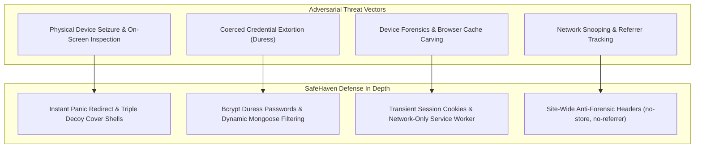
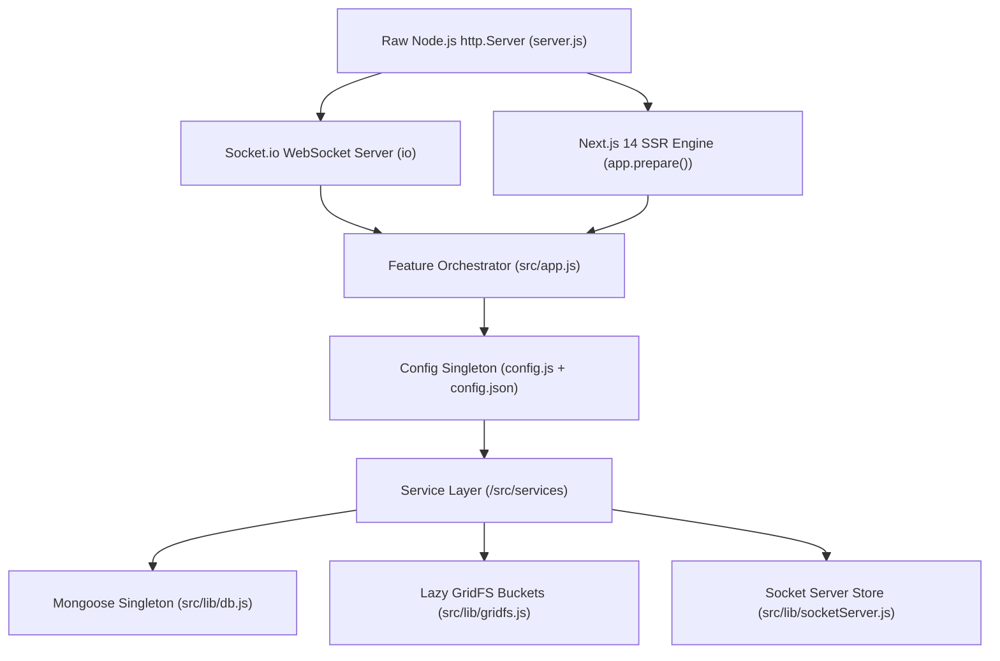
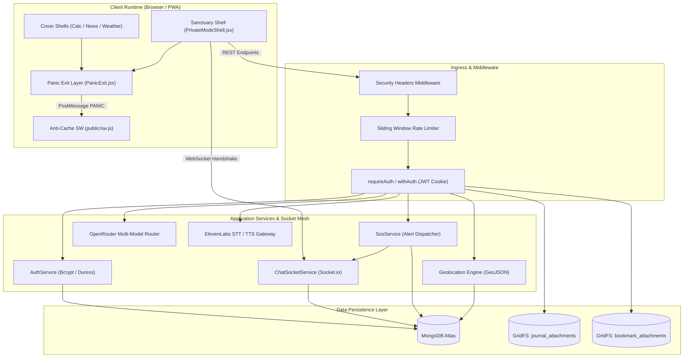
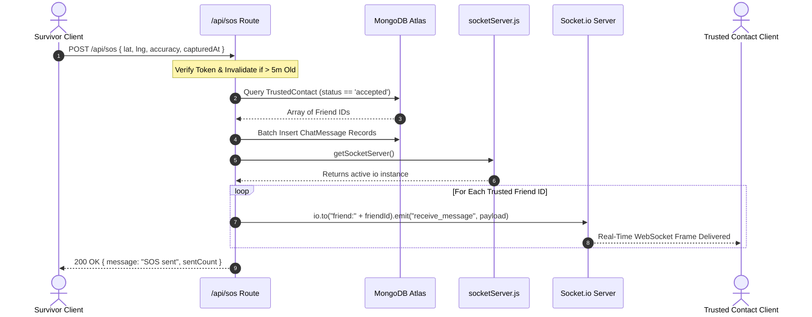
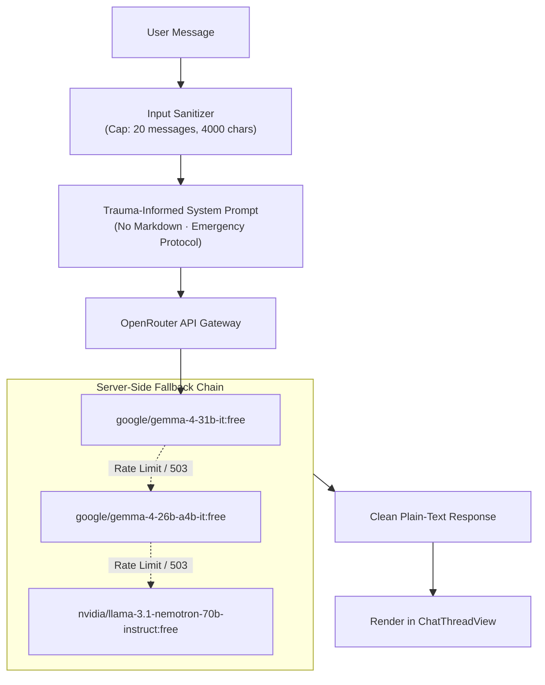
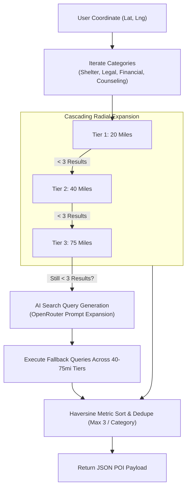
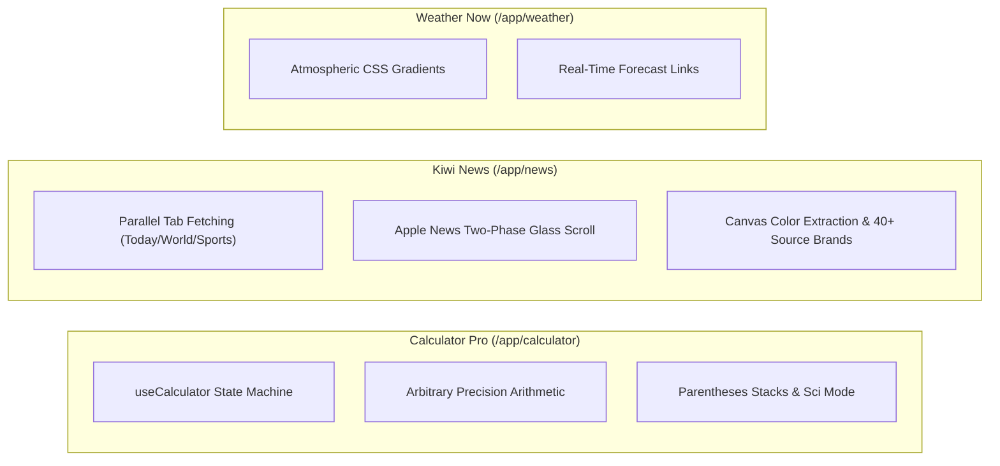

# SafeHaven

> **Discreet, Zero-Trace Crisis Intervention Platform & Real-Time Sanctuary Mesh**

[-000000?style=flat-square&logo=nextdotjs)](https://nextjs.org/)
[](https://react.dev/)
[](https://socket.io/)
[](https://www.mongodb.com/)
[](https://mongoosejs.com/)
[](https://openrouter.ai/)
[](https://www.mapbox.com/)
[](https://elevenlabs.io/)
[](https://developer.mozilla.org/en-US/docs/Web/Progressive_web_apps)
[](https://nodejs.org/api/crypto.html)

---

## Table of Contents

- [1. System Vision & Threat Modeling](#1-system-vision--threat-modeling)
- [2. Architectural Design Patterns & System Isolation](#2-architectural-design-patterns--system-isolation)
- [3. End-to-End System Architecture](#3-end-to-end-system-architecture)
- [4. Repository Taxonomy & File Map](#4-repository-taxonomy--file-map)
- [5. Zero-Trace Security, Duress Core & Forensic Evasion](#5-zero-trace-security-duress-core--forensic-evasion)
- [6. Real-Time Emergency Mesh & Incident Dispatch](#6-real-time-emergency-mesh--incident-dispatch)
- [7. Private Evidence Journal & Media Streaming Engine](#7-private-evidence-journal--media-streaming-engine)
- [8. Multi-Model Support Chat & Trauma-Informed Pipeline](#8-multi-model-support-chat--trauma-informed-pipeline)
- [9. Geospatial Search & Cascading Aid Discovery](#9-geospatial-search--cascading-aid-discovery)
- [10. Functional Decoy Systems (Cover Operating Modes)](#10-functional-decoy-systems-cover-operating-modes)
- [11. Subsystem Configuration Matrix & Feature Toggles](#11-subsystem-configuration-matrix--feature-toggles)
- [12. Local Environment Setup & Runbook](#12-local-environment-setup--runbook)

---

## 1. System Vision & Threat Modeling

Survivors of domestic violence, coercive control, and stalking navigate an adversarial threat model where their physical devices (smartphones, shared laptops, tablets) are routinely inspected by abusers. Standard privacy tools fail under this scrutiny: clearing browser histories triggers suspicion, generic safety websites look out of place when discovered, and traditional mobile apps leave purchase histories, push notifications, and forensic traces on-disk.

**SafeHaven** addresses this asymmetric vulnerability by providing an encrypted, zero-trace safety sanctuary disguised behind three fully functional, mathematically accurate cover utilities: **Calculator Pro**, **Kiwi News**, and **Weather Now**.

### Adversarial Threat Matrix & Defense Strategy



- **Physical Inspection:** Disguised as legitimate utility apps. A persistent panic engine ensures desktop keystrokes (`Escape`), touch gestures (horizontal swipe), or tap buttons redirect to the decoy surface *before* executing session purges.
- **Forced Access (Duress):** If coerced into authenticating, a secondary **Duress Password** unlocks a decoy view. The signed JWT sets `duressMode: true`, dynamically altering database queries to strip private entries without tipping off the adversary.
- **Forensic Disk Residue:** The custom Service Worker operates exclusively as an anti-cache daemon, purging `CacheStorage` instances on install, activation, and hide events. Responses carry strict HTTP `no-store` headers to prevent back-forward cache (`bfcache`) reconstruction.

---

## 2. Architectural Design Patterns & System Isolation

SafeHaven relies on strict architectural boundaries to balance production reliability with forensic evasion:



### 1. Custom HTTP Server with Unified WebSocket Upgrades
Next.js standard serverless handlers abstract away the raw Node.js `http.Server` instance, preventing WebSocket upgrade hooks. `server.js` boots Next.js inside a custom Node.js HTTP server, allowing `Socket.io` to attach directly to the HTTP transport layer on the same port while Next.js handles route compilation and SSR.

### 2. Centralized Feature Orchestration
All application subsystems (PWA, Auth, Chat, Journal, AI, Geolocation, SOS, Trusted Contacts) are gated through `src/app.js`. Subsystem classes expose static `init()` methods that evaluate against public toggles in `src/config/config.json` merged with environment secrets via `src/config/config.js`. Features remain completely dark if disabled.

### 3. Cached DB Connection & Lazy GridFS Initialization
Hot-module reloads in development and serverless recycling in production can exhaust database connection pools. `src/lib/db.js` caches the Mongoose connection promise on `global._mongooseCache`. GridFS storage buckets (`journal_attachments`, `bookmark_attachments`) are initialized lazily upon first invocation to ensure the underlying database connection has established before bucket instantiation.

---

## 3. End-to-End System Architecture



---

## 4. Repository Taxonomy & File Map

```text
safehaven/
├── server.js                          # Custom HTTP server; Next.js + Socket.io bootstrap
├── next.config.js                     # Global security & anti-caching response headers
├── public/
│   ├── manifests/                     # Decoy Web App Manifests
│   │   ├── calculator.json            # PWA Metadata: "Calculator Pro"
│   │   ├── news.json                  # PWA Metadata: "Daily News Reader"
│   │   └── weather.json               # PWA Metadata: "Weather Now"
│   ├── sw.js                          # Privacy-first network-only Service Worker
│   └── resources/images/logos/        # Multi-resolution cover app icons (32-512px)
└── src/
    ├── app.js                         # Central subsystem feature orchestrator
    ├── config/
    │   ├── config.json                # Public feature toggles & runtime flags
    │   └── config.js                  # Singleton merging config.json with process.env
    ├── lib/
    │   ├── db.js                      # Cached global Mongoose connection singleton
    │   ├── gridfs.js                  # Lazy GridFS bucket instantiator (attachments)
    │   ├── multerHelper.js            # Memory-buffered multipart upload parser (50MB cap)
    │   ├── openrouter.js              # OpenRouter API client with fallback array routing
    │   ├── requireAuth.js             # API route JWT authentication wrapper
    │   ├── withAuth.js                # getServerSideProps auth redirect wrapper
    │   ├── withOptionalAuth.js        # getServerSideProps optional session injector
    │   └── socketServer.js            # Global reference store for Socket.io instance
    ├── middleware/
    │   ├── rateLimit.js               # In-memory sliding window IP rate limiter
    │   └── securityHeaders.js         # Strict Cache-Control, CSP, & iframe busters
    ├── models/
    │   ├── User.js                    # Survivor accounts, Bcrypt hooks, duress hashes
    │   ├── UserLocation.js            # GeoJSON 2dsphere point coordinate store
    │   ├── Friend.js                  # Bidirectional friend graph & 30-day expiry clauses
    │   ├── TrustedContact.js          # SOS alert recipient whitelist
    │   ├── ChatMessage.js             # Room-scoped persistent messages
    │   ├── JournalEntry.js            # Incident documentation & inline media metadata
    │   └── Bookmark.js                # AI guidance, hotlines, & safety bookmarks
    ├── services/                      # Subsystem business logic & lifecycles
    │   ├── authService.js             # Dual-password authentication & transient cookies
    │   ├── chatSocketService.js       # Authenticated WebSocket rooms & persistence
    │   ├── sosService.js              # Real-time emergency location broadcast
    │   ├── journalPrivacyService.js   # Session-aware duress query filter engine
    │   ├── journalService.js          # Journal verification & GridFS storage lifecycles
    │   ├── aiChatService.js           # Trauma-informed inference configuration
    │   ├── geolocationService.js      # Single-position spatial coordinate manager
    │   ├── friendService.js           # Anonymous display name relationship graph
    │   ├── trustedContactService.js   # Emergency contact verification layer
    │   ├── bookmarkService.js         # Saved safety resource storage manager
    │   ├── buttonService.js           # Cover access button registration
    │   └── pwaService.js              # Manifest validation & install bootstrapper
    ├── hooks/
    │   ├── usePrivacyMode.js          # SW cache flush, history lock, panic hooks
    │   ├── useCalculator.js           # Math state machine (std & scientific evaluation)
    │   ├── useChat.js                 # Dynamic client socket.io lifecycle & events
    │   ├── useGeolocation.js          # Device location polling & remote sync
    │   └── useSpeechToText.js         # MediaRecorder buffer capture to ElevenLabs proxy
    ├── utils/
    │   ├── calcUtils.js               # Pure math evaluation, formatting, & token lexing
    │   ├── chatUtils.js               # Name avatar initials & payload serializers
    │   ├── colorExtract.js            # HTML Canvas accent color extractor for news heroes
    │   ├── newsUtils.js               # Article normalization & responsive formatters
    │   └── sourceBrands.js            # Publisher typography, domains, and branding maps
    ├── components/
    │   ├── PanicExit.jsx              # Escape key, swipe gesture, & panic triggers
    │   ├── PrivateModeButton.jsx      # Discreet access trigger dot on decoy apps
    │   ├── calc-mode/                 # Calculator Cover (Display, SciPad, StdPad, History)
    │   ├── news-mode/                 # Kiwi News Cover (FeedHeader, HeroStory, StorySection, TabBar)
    │   ├── weather-mode/              # Weather Now Cover (Animated SVG sky, temperature cards)
    │   └── private-mode/              # Safety Sanctuary (Shell, Home, SOS, Chat, Journal, Aid)
    └── pages/
        ├── _app.jsx                   # Global styles & Mapbox GL CSS injection
        ├── index.jsx                  # Public landing presentation
        ├── login.jsx                  # Zero-trace login/register view
        ├── downloads.jsx              # PWA installation instructions
        ├── app/[theme].jsx            # Auth-gated shell routing to cover or sanctuary
        ├── preview/[theme].jsx        # Public demo routes of cover apps
        └── api/                       # REST endpoints (auth, journal, sos, chat, etc.)
```

---

## 5. Zero-Trace Security, Duress Core & Forensic Evasion

### 1. Volatile Cookie Protocol & Dual-Credential Authentication
Standard web authentication utilizes persistent session tokens written to `localStorage` or set with long-lived cookie expirations. SafeHaven enforces a **Zero-Trace Credential Contract** (`src/services/authService.js`):

```javascript
static _makeAuthCookie(token) {
  const parts = [
    `auth_token=${token}`,
    'HttpOnly',
    'Path=/',
    'SameSite=Strict',
    ...(config.env.NODE_ENV === 'production' ? ['Secure'] : []),
    // NO Max-Age, NO Expires -> Session cookie purged on window close
  ];
  return parts.join('; ');
}
```

- **Ephemeral JWTs:** JWTs are signed with a 24-hour server ceiling but delivered exclusively via HTTP-only, `SameSite=Strict` cookies omitting `Max-Age` and `Expires`. The browser deletes the token the moment the window or tab is destroyed.
- **Duress Credential Branching:** User accounts store two distinct bcrypt hashes (12 salt rounds): `passwordHash` and an optional `duressPasswordHash`.
  - **Standard Password:** Returns `{ sub: user._id, displayName: user.anonymousDisplayName }`.
  - **Duress Password:** Returns `{ sub: user._id, displayName: user.anonymousDisplayName, duressMode: true }`.
- **Anti-Autofill Input Masking:** To block Chrome, Safari, and password managers (1Password, LastPass) from prompting to save credentials or autocompleting forms, input elements use `type="text"`, `-webkit-text-security: disc`, `autoComplete="off"`, `data-lpignore="true"`, and `data-1p-ignore="true"`.

### 2. Network-Only Anti-Cache Service Worker (`public/sw.js`)
Typical PWAs prioritize offline functionality by caching assets in `CacheStorage`. SafeHaven inverts this behavior to guarantee forensic non-retention:

```javascript
// Actively delete all caches on installation and activation
self.addEventListener('install', (event) => {
  event.waitUntil(purgeAllCaches().then(() => self.skipWaiting()));
});

self.addEventListener('activate', (event) => {
  event.waitUntil(purgeAllCaches().then(() => self.clients.claim()));
});

// Network-only fetch strategy with generic fallback
self.addEventListener('fetch', (event) => {
  if (event.request.method !== 'GET') return;
  event.respondWith(
    fetch(event.request).catch(() => {
      return new Response('<!DOCTYPE html><html><body>Offline</body></html>', {
        status: 503,
        headers: { 'Content-Type': 'text/html' }
      });
    })
  );
});
```

### 3. Dynamic Duress Query Stripping (`src/services/journalPrivacyService.js`)
When an account authenticates under duress, the application must not display obvious discrepancies such as empty account screens or alert warnings. The database query layer dynamically inspects the decrypted session token:

```javascript
static getPrivacyFilter(session) {
  if (session && session.duressMode) {
    return { isPrivate: { $ne: true } };
  }
  return {};
}
```
All queries to `/api/journal` transparently inject `{ isPrivate: { $ne: true } }`, hiding sensitive evidence documentation while presenting public community entries to convince an observer that the account contains no private records.

### 4. Zero-Latency Multi-Vector Panic Exit
Exiting the sanctuary must be instantaneous. The panic pipeline triggers three actions in parallel:
1. **Immediate Decoy Navigation:** Instantly invokes `window.location.replace('/app/calculator')`, forcing the browser to load the cover UI before dispatching network requests.
2. **Service Worker Message Dispatch:** Broadcasts `{ type: 'PANIC' }` to `navigator.serviceWorker`, instructing the background worker to iterate over `caches.keys()` and purge all cache instances.
3. **Server Session Revocation:** Fires an asynchronous beacon to `/api/auth/logout`, setting `Max-Age=0` to clear the `auth_token` cookie.

---

## 6. Real-Time Emergency Mesh & Incident Dispatch

SafeHaven provides a friend-gated communication pipeline supporting peer-to-peer messaging and emergency SOS broadcasts.



### 1. Anonymous Friend Relational Graph
- **No Real Names:** Real account usernames are scrubbed during registration (`select: false`). Users discover peers via random generated identifiers (e.g., `WarmLight4021`).
- **Bidirectional Invariant Enforcement:** Friend links use a composite key:
  $$\text{pairKey} = [\text{userIdA}, \text{userIdB}].\text{sort}().\text{join}(':');$$
  This ensures only one relational state (`pending`, `accepted`, `rejected`) exists between any two users.
- **30-Day Auto-Pruning:** Unaccepted pending requests older than 30 days are automatically excluded from API queries and purged to prevent old unaccepted records from lingering.

### 2. Socket Handshake & Room Authorizations (`src/services/chatSocketService.js`)
- WebSocket connections authenticate during the initial handshake by parsing the `cookie` header and verifying the enclosed JWT.
- Clients join rooms (`friend:${relationshipId}`) only after the server verifies an `accepted` database record exists where `session.userId` matches either the requester or recipient.

### 3. Emergency SOS Dispatch Pipeline (`src/pages/api/sos/index.js`)
When an emergency SOS is triggered:
- The server validates coordinate bounds ($\text{lat} \in [-90, 90]$, $\text{lng} \in [-180, 180]$) and rejects coordinates with timestamps older than 5 minutes ($300{,}000\text{ ms}$).
- Identifies all records in `TrustedContact` associated with the sender.
- Constructs an emergency payload containing a direct Google Maps link and accuracy radius:
  ```text
  SOS: WarmLight4021 might be in danger. Current location: https://maps.google.com/?q=38.5816,-121.4944. Accuracy: about 15 m.
  ```
- Writes the message to `ChatMessage` and accesses the global Socket.io instance via `src/lib/socketServer.js` to dispatch WebSocket packets directly to `friend:${friendId}`.

---

## 7. Private Evidence Journal & Media Streaming Engine

The evidence journal allows survivors to capture admissible incident documentation (photos of injuries, audio recordings of threats, court documents, property damage).


### 1. In-Memory Upload Processing (`src/lib/multerHelper.js`)
To prevent forensic traces on local storage, uploads are buffered in RAM up to 50 MB rather than written to `/tmp`. Accepted MIME types include:
- **Images:** `image/jpeg`, `image/png`, `image/gif`, `image/webp`, `image/heic`, `image/heif`
- **Video:** `video/mp4`, `video/quicktime`, `video/x-msvideo`, `video/webm`, `video/x-matroska`
- **Audio:** `audio/mpeg`, `audio/mp4`, `audio/wav`, `audio/x-m4a`, `audio/ogg`
- **Documents:** `application/pdf`

The memory buffer streams into the MongoDB `journal_attachments` GridFS bucket via `Readable.from(buffer).pipe(uploadStream)`.

### 2. HTTP 206 Byte-Range Streaming (`src/pages/api/journal/attachment/[fileId].js`)
Mobile Safari and Chromium require HTTP 206 Partial Content support for seeking through audio voice memos and video evidence. SafeHaven implements a custom range parser on top of GridFS download streams:

```javascript
const range = req.headers.range;
if (range) {
  const parts = range.replace(/bytes=/, "").split("-");
  const start = parseInt(parts[0], 10);
  const end = parts[1] ? parseInt(parts[1], 10) : fileMetadata.length - 1;
  const chunksize = (end - start) + 1;

  res.status(206);
  res.setHeader('Content-Range', `bytes ${start}-${end}/${fileMetadata.length}`);
  res.setHeader('Content-Length', chunksize);

  const downloadStream = bucket.openDownloadStream(fileObjectId, {
    start,
    end: end + 1 // GridFS end boundary is exclusive
  });
  downloadStream.pipe(res);
}
```

---

## 8. Multi-Model Support Chat & Trauma-Informed Pipeline

SafeHaven's support assistant (`SafeBot`) provides trauma-informed safety planning and emotional support.



### 1. Trauma-Informed Conversation Guardrails
The system prompt in `src/pages/api/ai-chat/index.js` enforces specific conversational boundaries:
- **Immediate Threat Detection:** Surfaces the National Domestic Violence Hotline (1-800-799-7233) and 911 when life-safety risks are detected.
- **No Diagnostics:** Validates emotional experiences and directs users to licensed professionals rather than diagnosing conditions.
- **Strict Formatting Guardrail:** Completely suppresses markdown, LaTeX, and bold asterisks (`**`). The output is restricted to plain text and simple hyphen bullets (`-`) to ensure readability on small screens during high-stress situations.

### 2. Multi-Model Fallback Infrastructure (`src/lib/openrouter.js`)
To prevent outages when using free-tier inference endpoints, requests route through OpenRouter's native fallback mechanism:

```javascript
const response = await createChatCompletion({
  models: [
    'google/gemma-4-31b-it:free',
    'google/gemma-4-26b-a4b-it:free',
    'nvidia/llama-3.1-nemotron-70b-instruct:free'
  ],
  max_tokens: 1024,
  messages: [{ role: 'system', content: SYSTEM_PROMPT }, ...sanitizedMessages]
});
```
If the primary Gemma model is unavailable or rate-limited, OpenRouter automatically fails over down the chain on the server side without dropping the client request.

### 3. Voice Transcription & Speech Processing (`src/pages/api/stt/index.js`)
Survivors under physical distress can dictate journal entries and messages using voice input.
- Browser client captures microphone buffers via the `MediaRecorder` API.
- The binary audio blob posts to `/api/stt`.
- The endpoint inspects the multipart payload and forwards the stream to ElevenLabs' `scribe_v1` transcription model using the server-side `ELEVENLABS_API_KEY`.
- Audio playback for reading accessibility routes through `/api/tts`, which streams MP3 audio back to the browser using the ElevenLabs `eleven_turbo_v2` model.

---

## 9. Geospatial Search & Cascading Aid Discovery

The Aid system (`/api/resources/nearby`) provides proximity-based discovery of domestic violence shelters, pro-bono legal clinics, emergency financial services, and mental health counseling.



### 1. Rate-Throttled Batching
Mapbox Search Box API limits request concurrency. The engine executes category lookups sequentially, batching queries in groups of 3 with a $150\text{ ms}$ delay (`MAPBOX_BATCH_DELAY_MS`) between batches to avoid HTTP 429 errors.

### 2. Cascading Radial Search & AI Query Expansion
To surface resources in both dense urban centers and rural areas:
- **Radial Tiers:** Searches expand through three concentric bounding boxes: $20\text{ mi} \to 40\text{ mi} \to 75\text{ mi}$.
- **Target Threshold:** Iteration stops as soon as 3 verified POIs are discovered for a category.
- **Prompt-Generated Fallback:** If rural searches yield fewer than 3 results across all tiers, `generateFallbackQueries()` prompts OpenRouter to expand localized search phrases (e.g., generating terms like *"county human assistance"*, *"crisis family shelter"*) and re-executes against the outer search bounds.

### 3. Spatial Sorting via Haversine Distance
Candidate coordinates are calculated using the Haversine formula:
$$d = 2R \cdot \arcsin\left(\sqrt{\sin^2\left(\frac{\Delta\phi}{2}\right) + \cos(\phi_1)\cos(\phi_2)\sin^2\left(\frac{\Delta\lambda}{2}\right)}\right)$$
Results are sorted strictly by ascending distance to ensure the nearest resources appear first.

---

## 10. Functional Decoy Systems (Cover Operating Modes)

SafeHaven’s cover applications are fully functional utilities designed to withstand interactive scrutiny.



### 1. Calculator Pro (`src/hooks/useCalculator.js`)
An iOS-style calculator supporting standard and scientific evaluation.
- **Expression Evaluation:** Manages an operator precedence stack supporting basic arithmetic ($+$, $-$, $\times$, $\div$), powers ($x^y$), roots ($^y\sqrt{x}$), factorials ($x!$), logarithms ($\ln$, $\log_{10}$), and trigonometric calculations ($\sin$, $\cos$, $\tan$ with Radian/Degree switching).
- **Parentheses Stack Engine:** Nested brackets are maintained via `parenStack`, allowing complex mathematical inputs without syntax errors.
- **Dynamic Font Scaling:** Monitors formatted output string length, dynamically stepping down typography from $82\text{px} \to 66\text{px} \to 52\text{px} \to 38\text{px}$ to prevent text clipping.

### 2. Kiwi News (`src/components/news-mode/NewsShell.jsx`)
An Apple News-inspired reader pulling from 40+ major news brands.
- **Two-Phase Sticky Scroll:** `ArticleOverlay.jsx` tracks scroll position relative to the hero element. As the user scrolls, the article title transitions to a sticky top bar, while the reading pane switches dynamically from `overflow-y: hidden` to `overflow-y: auto` once crossing the $130\text{px}$ threshold.
- **Canvas Accent Sampling:** `src/utils/colorExtract.js` renders headline images onto an off-screen HTML5 Canvas ($40 \times 40\text{ px}$), extracts non-extreme RGB averages, and applies dynamic color tinting to feed cards.
- **Publisher Branding Map:** `src/utils/sourceBrands.js` maps publisher names to brand colors and brand icons (Reuters, AP, BBC, NYT, Bloomberg, etc.).

### 3. Weather Now (`src/components/weather-mode/WeatherModeShell.jsx`)
A lightweight, believable weather utility featuring dynamic SVG atmospheric elements and external forecast links.

---

## 11. Subsystem Configuration Matrix & Feature Toggles

Subsystems are toggled in `src/config/config.json`, allowing services to be enabled or disabled without touching application code.

| Feature Toggle Key | Default | Subsystem Activated | Service Engine Binding |
| :--- | :---: | :--- | :--- |
| `enable_auth_system` | `true` | JWT register/login/logout & duress handling | `AuthService.init()` |
| `enable_anonymous_chat`| `true` | Socket.io friend-to-friend messaging mesh | `ChatSocketService.init(io)` |
| `enable_sos` | `true` | Emergency broadcast messaging to trusted contacts | `SosService.init(io)` |
| `enable_journal` | `true` | Evidence documentation & GridFS attachments | `JournalService.init()` |
| `enable_journal_privacy`| `true` | Duress-aware database query filtering | `JournalPrivacyService` |
| `enable_ai_chat` | `true` | SafeBot support chat via OpenRouter | `AiChatService.init()` |
| `enable_bookmarks` | `true` | Saved hotlines, advice, and evidence storage | `BookmarkService.init()` |
| `enable_geolocation` | `true` | Single-record spatial location tracking | `GeolocationService.init()` |
| `enable_friending` | `true` | Anonymous display name relational graph | `FriendService.init()` |
| `enable_trusted_contacts`| `true` | Allowlist configuration for SOS notifications | `TrustedContactService.init()` |
| `enable_friend_request_expiry` | `true` | 30-day auto-pruning for pending requests | Query-level filter |
| `enable_pwa` | `true` | Manifest verification & install lifecycle | `PwaService.init()` |
| `enable_swipe_panic` | `true` | Horizontal touch gesture panic trigger | `PanicExit.jsx` |
| `enable_button` | `true` | Discreet corner entry dot on cover shells | `ButtonService.init()` |
| `enable_safety_alert` | `false` | Visual/auditory alarm beacon (in development) | Reserved |
| `enable_resource_directory` | `false` | Directory search enhancements (in development)| Reserved |
| `enable_crisis_escalation` | `false` | Automated crisis line handover (in development)| Reserved |

---

## 12. Local Environment Setup & Runbook

### Prerequisites
- **Node.js:** v18.0.0 or higher
- **npm:** v9.0.0 or higher
- **MongoDB:** Atlas cluster or local MongoDB instance (v6.0+)
- **Mapbox Account:** Public and secret access tokens for map rendering and POI discovery
- **OpenRouter Account:** API key for multi-model AI support

---

### Step 1: Clone & Install Dependencies
```bash
git clone https://github.com/your-org/safehaven.git
cd safehaven
npm install
```

---

### Step 2: Environment Configuration
Copy `.env.example` to `.env`:
```bash
cp .env.example .env
```

Populate the required configuration keys:

| Environment Variable | Required | Description |
| :--- | :---: | :--- |
| `PORT` | Optional | Local port for custom HTTP server (default: `3000`) |
| `NODE_ENV` | Required | Set to `development` or `production` |
| `MONGODB_URI` | Required | MongoDB connection string (e.g., `mongodb+srv://...`) |
| `JWT_SECRET` | Required | 64-char hex secret for signing tokens (`crypto.randomBytes(32).toString('hex')`) |
| `OPENROUTER_API_KEY` | Required | OpenRouter authorization token for LLM routing |
| `NEXT_PUBLIC_MAPBOX_TOKEN`| Required | Public Mapbox token for client-side vector map rendering |
| `MAPBOX_ACCESS_TOKEN` | Optional | Server-side token for Search Box API (defaults to public token if unset) |
| `ELEVENLABS_API_KEY` | Optional | API key for speech-to-text and audio reading features |
| `NEXT_PUBLIC_SAFE_EXIT_URL`| Optional | Destination URL for panic redirection (default: `https://www.google.com`) |
| `ALLOWED_ORIGIN` | Optional | Production CORS origin check for Socket.io handshakes |

---

### Step 3: Run Seed Script (Optional)
To populate demo friend relationships, test accounts, and sample community journal entries:
```bash
node scripts/seed-demo.js
```

---

### Step 4: Boot Application
```bash
# Run development server with live reload
npm run dev

# Run production build
npm run build

# Boot production instance with custom WebSocket server
npm start
```

---

### Step 5: Verify Startup Telemetry
When `server.js` boots, `src/app.js` runs each subsystem's initialization checks:

```text
[PwaService] PWA ready. Safe-exit URL: https://www.google.com
[PwaService] Cover identities: calculator.json, news.json, weather.json
[AuthService] Zero-trace auth system initialized.
[ChatSocketService] Friend-gated persistent chat enabled.
[JournalService] Private evidence journal initialized.
[JournalService] Attachment storage: MongoDB GridFS (journal_attachments).
[AiChatService] AI support chat initialized (OpenRouter / google/gemma-4-31b-it:free).
[BookmarkService] Bookmark system initialized.
[BookmarkService] Attachment storage: MongoDB GridFS (bookmark_attachments).
[ButtonService] Discreet SOS chat button enabled.
[GeolocationService] Opt-in latest-location storage enabled.
[FriendService] Anonymous friending enabled.
[TrustedContactService] Trusted contact allowlist enabled.
[SosService] Trusted-contact SOS messaging enabled.
> Ready on http://localhost:3000 [development]
[AuthService] MongoDB connected.
```

---

## License

This project is licensed under the MIT License. Built for survivor safety, human agency, and digital privacy.
